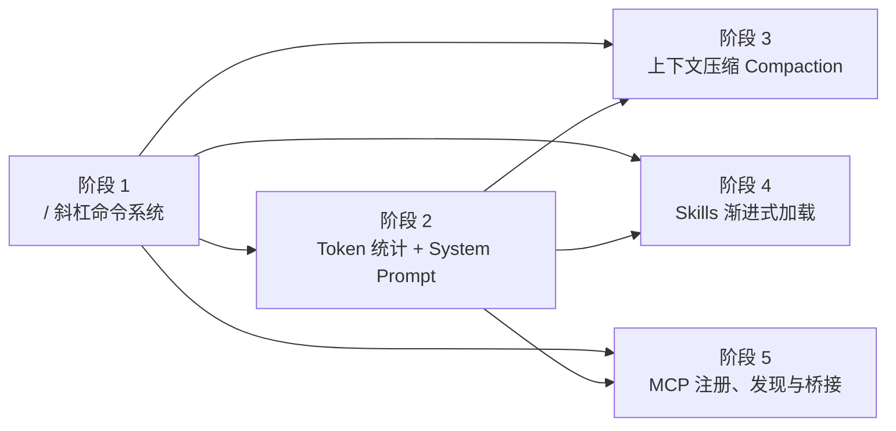

# SAISON 下一阶段能力演进计划

本文规划 SAISON 在完成「多模态图片 + DeepSeek Files API 与文档解析」里程碑后的下一阶段演进，覆盖 6 项核心能力：**`/` 斜杠命令系统、Token 与上下文统计、System Prompt、上下文压缩（Compaction）、Skills 渐进式加载、MCP 注册与发现**。

> 设计目标：保持现有自底向上分层（`apis` → `config`/`storage`/`tools` → `agent` → `interaction/{gui,cli}` → `cmd`），先建立统一的 `/` 快捷控制入口，再逐步把统计、System Prompt、压缩、Skills 与 MCP 以插件式命令与底层能力接进来；每个阶段都可独立实现、独立验证、单独提交。

---

## 整体依赖与推进顺序



- **阶段 1 先搭 `/` 统一入口**：立即接入已有的思考开关/强度（`/think`）、新建会话（`/new`）、重命名（`/rename`）与 `/help`，并沉淀 GUI `/` 补全浮层与本地反馈卡片；后续所有新功能只需往注册表挂命令，避免交互返工。
- **阶段 2 打好底层数据与提示词管道**：盘活 `api_calls` 提供真实 Token 观测，建立动态 System Prompt 拼装管道，作为压缩、Skills 索引与 MCP 成本观测的共同地基。
- **阶段 3 → 5 增量挂接**：依次接入上下文压缩（`/compact`）、Skills 渐进式加载（`/skills` 与动态 `/<skill-name>`）以及 MCP 工具发现与桥接（`/mcp`）。

---

## 阶段 1：`/` 斜杠命令系统

### 1.1 架构分层（GUI 与 CLI 共用）

- 新增独立的命令解析与注册包（如 `internal/commands`），模式参考 `internal/tools.Registry`，让 **GUI 和 CLI 共用命令定义、前缀匹配、参数解析与执行分发**。
- 命令定义包含：`Name`、`Usage`、`Description`、`Complete`（可选参数补全，如 `/think` 的 `on/off/low/high/max`）与 `Run(ctx, args) (Result, error)`。
- **预留动态命令源**：注册表同时支持静态内建命令与动态命令提供器，便于阶段 4 将已发现的 Skills（`/<skill-name>`）直接并入同一套 `/` 补全浮层。
- 执行结果区分两类：
  - **本地信息反馈**（如 `/help`、查看 `/think` 或 `/usage`）：仅在当前端以轻量提示卡片/终端文本展示，**不写入 `messages` 表，不发送给模型**。
  - **会话/应用动作**（如切换思考强度、新建/重命名会话、执行压缩）：直接驱动现有状态机与控制器方法。

### 1.2 命令演进总表

| 命令 | 接入阶段 | 作用 |
| --- | --- | --- |
| `/help` | 阶段 1 | 列出所有可用命令及简要用法 |
| `/think [on \| off \| low \| high \| max]` | 阶段 1 | 无参查看当前思考状态；`off` 关闭（保留原强度）；`on` 开启；`low/high/max` 自动开启并切换强度，与 GUI 选项浮层共用 `sessionState.opts` 实时同步 |
| `/new [标题]` | 阶段 1 | 快速新建会话 |
| `/rename <新标题>` | 阶段 1 | 重命名当前会话 |
| `/usage` | 阶段 2 | 查看当前会话上下文占用、累计 token、缓存命中率与调用次数 |
| `/system [内容 \| clear]` | 阶段 2 | 查看、设置或清空当前会话 System Prompt |
| `/compact [聚焦说明]` | 阶段 3 | 压缩当前会话上下文，展示压缩前后 token 变化 |
| `/skills [reload]` / `/<skill-name>` | 阶段 4 | 查看/重载 Skills，或直接显式激活指定 Skill |
| `/mcp [reconnect <name>]` | 阶段 5 | 查看各 MCP Server 连接状态、暴露工具列表与重连 |

### 1.3 GUI 交互规范

- 输入框首行以 `/` 开头时，在输入框上方弹出紧凑命令补全浮层：
  - 实时按前缀过滤（输入 `/th` 高亮 `/think`，输入 `/think ` 提示 `on / off / low / high / max`）；
  - 支持 `↑`/`↓` 切换、`Tab` 补全命令名、`Enter` 执行（需必填参数时优先补全）、`Esc` 关闭；
  - 正在生成或附件上传阻塞期间禁用会变更对话流的命令（如 `/compact`、`/new`），只读查询类命令仍可响应。

---

## 阶段 2：Token 用量统计与 System Prompt

### 2.1 Token 与上下文统计（激活现有 `api_calls` 表）

`internal/storage/schemas.go` 从 v1 就已建好 `api_calls` 表（`prompt_tokens`、`completion_tokens`、`prompt_cache_hit_tokens`、`prompt_cache_miss_tokens`、`finish_reason`、`duration_ms`），但尚未写入与展示。

- **协议层（`internal/apis`）**：
  - `chatRequest` 增加 `stream_options: {"include_usage": true}`。
  - `types.go` 增加 `Usage` 结构（`PromptTokens`、`CompletionTokens`、`TotalTokens`、`PromptCacheHitTokens`、`PromptCacheMissTokens`）与 `EventUsage` 事件类型。
  - **关键注意点**：兼容协议的 `usage` 通常随流末尾一帧 `choices: []` 的 chunk 返回，[sse.go](../internal/apis/sse.go) 必须在判断 `len(chunk.Choices) == 0` 之前先提取并上抛 `EventUsage`。
- **存储层（`internal/storage`）**：
  - 新增 `RecordAPICall(ctx, call)` 与 `GetSessionUsage(ctx, sessionID)`。
  - 区分两类口径：
    - **当前上下文占用**：取该会话**最新一条** `api_calls` 的 `prompt_tokens + completion_tokens`（判断是否接近上下文上限）。
    - **会话累计消耗**：对该会话全部 `api_calls` 求和，并计算缓存命中率 `cache_hit / prompt_tokens`。
- **调度与展示（`internal/agent` / `gui` / `cli`）**：
  - `agent.Loop` 在每次 `StreamChat` 结束时记录耗时与 `Usage` 并写入 `api_calls`，通过 `OutputEvent` 通知上层刷新。
  - 注册 `/usage` 命令，同时在 GUI 输入区或顶栏展示精简的当前上下文占用提示。

### 2.2 System Prompt 分层拼装

- **核心原则：动态头部注入，不写死为 `messages` 表第一条记录**。
  - 修改全局或会话 System Prompt 后对老会话下一轮立即生效；
  - 上下文压缩时天然保留完整 System Prompt；
  - 历史消息展示保持纯粹，不混入系统指令。
- **三层拼装顺序**（在 `agent.Loop` 构建请求消息时执行）：
  1. **内置运行时上下文（轻量、自动生成）**：当前日期、操作系统与可用工具概况、当前会话 `WorkDir`（阶段 4 的 Skills 索引清单也挂在这一层之后）。
  2. **全局默认 System Prompt**：持久化于 `config.json`（`system_prompt` 字段），可通过 GUI 设置弹框编辑。
  3. **会话级 System Prompt（可选）**：`sessions` 表 schema v4 新增 `system_prompt TEXT NOT NULL DEFAULT ''`，通过 `/system` 命令（及可选 GUI 入口）读写。

---

## 阶段 3：上下文压缩（Compaction）

### 3.1 存储与数据契约

- **核心原则：绝不物理删除原 `messages` 记录**，保留完整历史供用户回看与审计。
- **锚点摘要模型（schema v5）**：
  - 新增 `compactions` 表（支持同一长会话多次滚动压缩）：
    - `id`、`session_id`、`summary`（结构化压缩摘要）、`through_message_id`（已压缩覆盖到的最后一条消息 ID）、`tokens_before`、`tokens_after`、`created_at`。
  - **发给模型时（`agent.Loop`）**：读取最新一条有效 compaction，仅构造：
    `[动态 System Prompt] + [压缩摘要消息（标明为上文摘要）] + [id > through_message_id 的后续原文消息]`。
  - **界面展示时（`gui` / `cli`）**：完整保留历史消息，并在 `through_message_id` 位置插入一张可折叠的「以上对话已压缩（例如 28.4k → 2.6k tokens）」分隔卡片。

### 3.2 压缩安全边界

- **轮次完整性保护**：锚点 `through_message_id` 只能落在**完整轮次末尾**，绝不在 `assistant(tool_calls)` 与其对应的 `tool` 结果之间切分，避免下轮请求报 400。
- **可选保留尾部原文**：支持保留最近 `N` 轮完整原文（具体默认策略待确认），避免刚讨论的细节立即丢失。
- **聚焦与取消**：通过 `/compact [聚焦说明]` 传入 `focus` 拼进摘要提示词，执行期间复用 `turnCtx` 与停止按钮支持随时取消。
- **附带收益**：历史消息里的 `file_id` 超过 30 天过期后，压缩一次即可自然移出后续模型上下文，不再阻塞继续对话。

---

## 阶段 4：Skills 加载机制（渐进式披露）

参考开放 Agent Skills 规范，以 **「低 token 发现 + 按需加载正文」** 为核心，避免一次性把所有 Skill 全文塞进 System Prompt 浪费上下文。

### 4.1 Skill 目录与文件契约

- 每个 Skill 为一个独立目录，至少包含 `SKILL.md`：
  ```text
  my-skill/
  ├── SKILL.md          # 必填：YAML frontmatter (name, description) + Markdown 指令正文
  ├── references/       # 可选：按需读取的参考文档
  └── scripts/          # 可选：辅助脚本（不自动执行，仍受本地命令确认约束）
  ```
- **发现路径与覆盖优先级（高覆盖低）**：
  1. 当前工作区目录：`<WorkDir>/.saison/skills/`（可选兼容 `.agents/skills/`）
  2. 用户全局目录：`~/.saison/skills/`
  - 同名 Skill 按高优先级覆盖，并在 `/skills` 列表中标明来源路径。

### 4.2 两阶段加载流程

1. **发现期（常驻 System Prompt，极低开销）**：
   - `internal/skills` 扫描上述目录，仅解析每个 `SKILL.md` 头部 YAML frontmatter（校验必填的 `name`、`description`，跳过非法目录并记录告警，不阻塞启动）。
   - 向阶段 2 的动态 System Prompt 注入精简索引清单（仅含 `name` + `description`），并同步注册到阶段 1 的 `/` 动态命令源。
2. **激活期（按需拉取全文）**：
   - **模型自动触发**：向 `tools.Registry` 注册安全只读工具 `load_skill(name, resource?)`，模型判断任务匹配某 Skill 时调用该工具读取 `SKILL.md` 正文或该 Skill 目录内的参考文件。
   - **用户显式触发**：直接在输入框键入 `/<skill-name> [附加指令]`（在 `/` 补全浮层里与内建命令统一联想），将对应 Skill 正文注入本轮请求。
- **安全与边界**：
  - 严格限制 `load_skill` 只能读取目标 Skill 根目录内的相对路径（规范化校验 `filepath.Rel` 防止 `../` 路径穿越）；
  - 限制单次读取字节上限（如 64 KiB），防止误放超大文件冲爆上下文；
  - 支持 `/skills reload` 热刷新，修改或新增 Skill 无需重启 SAISON。

---

## 阶段 5：MCP 注册、发现与工具桥接

目标是把外部 MCP Server 的工具无缝接入现有 `internal/tools.Registry`，让 `agent.Loop`、工具确认卡、会话选项浮层与 `/mcp` 命令统一复用。

### 5.1 配置与注册（独立包 `internal/mcp`）

- 配置文件：独立本地文件 `mcp.json`（与 `config.json` 同级，加入 `.gitignore` 防止泄露鉴权 Token/Header；另提供 `mcp.example.json` 模板）。
- 每个 Server 条目包含：
  - `name`（唯一标识，用于命名空间与 UI 展示）
  - `transport`：`stdio` 或 `http`（Streamable HTTP）
  - `command` / `args` / `env`（`stdio` 模式）或 `url` / `headers`（`http` 模式，支持 `${ENV_VAR}` 占位符从环境变量读取密钥，避免明文落盘）
  - `enabled`（默认开关）、`timeout_sec`、`require_confirm`（默认 `true`，允许按 server 或工具标记只读免确认）

### 5.2 传输层与协议范围

- 遵循 MCP JSON-RPC 2.0 协议，首期聚焦最核心的 **Tools 能力**（`Resources` / `Prompts` 留作后续扩展）：
  - **`stdio` 传输**：以受控子进程启动（复用隐藏窗口配置兼容 Windows），通过 stdin/stdout 换行分隔 JSON-RPC 帧通信，stderr 收集最近 N 行用于排错；进程退出或应用关闭时发送关闭信号并限时强杀，防止孤儿进程残留。
  - **`Streamable HTTP` 传输**：复用统一 HTTP 客户端连接池，支持标准 JSON 响应与 `text/event-stream` 流式响应及 `Mcp-Session-Id` 维护。
- 握手与发现流程：
  1. `initialize`（声明客户端能力与协议版本）→ `notifications/initialized`
  2. `tools/list`（支持 `nextCursor` 分页拉全）→ 缓存该 Server 的工具元信息与 JSON Schema
  3. 执行调用 `tools/call` → 规范化提取返回的 `content`（文本拼接、错误标志 `isError` 透传给模型、超长结果按字符上限截断）

### 5.3 与现有 `tools.Registry` 和 GUI 的桥接

- **适配器模式**：新增 `mcpToolAdapter` 实现 `tools.Tool` 接口：
  - **命名空间防冲突**：注册工具名为 `mcp__<server>__<tool>`（仅使用 `[a-zA-Z0-9_-]`，严格兼容 OpenAI/DeepSeek function calling 命名正则），避免与内建 `bash`/`web_search` 或其他 MCP Server 重名。
  - **确认流复用**：默认走 `tools.ConfirmFunc` 弹出确认卡片（展示 server 名、工具名与格式化 JSON 参数）；仅当用户显式将某 server/tool 配为免确认时跳过弹窗。
- **容错与故障隔离**：
  - 应用启动或连接时**并行初始化**已启用的 MCP Server，单个 Server 启动失败、超时或运行期崩溃只将其标记为 `failed` 并记录错误，不影响应用启动及其他 Server / 内建工具。
  - 进程崩溃后支持 `/mcp reconnect <name>` 或下次调用时按需重连。
- **控制上下文膨胀**：
  - 复用 `composer.go` 的 `optionToggle` 机制，允许按 MCP Server 在会话内独立勾选启停，避免一口气把几十上百个工具 Schema 塞进每轮 `prompt_tokens`。

---

## 跨阶段工程与测试要求

1. **隐私与安全**：
   - `mcp.json` 加入 `.gitignore`，示例模板不含真实凭据；MCP 请求头与错误日志严格脱敏。
   - Skills 读取严格限制在 Skill 根目录内；MCP `stdio` 子进程退出必须回收，避免句柄与进程泄漏。
2. **分层测试（全部纳入 `go test -race`）**：
   - `commands`：静态/动态命令注册、前缀补全过滤、参数解析、`/think` 边界值与 GUI 补全浮层键盘导航单测。
   - `apis`：流式 `usage` 帧（含空 `choices`）解码单测。
   - `storage`：schema 迁移（v3 → v4/v5）、`api_calls` 统计口径、compaction 锚点读写与会话删除级联清理。
   - `agent`：System Prompt 动态拼装顺序、`Compact` 边界（不拆散 `tool_calls`）及历史裁剪后请求编码。
   - `skills`：frontmatter 解析、同名覆盖优先级、路径穿越拦截与热重载。
   - `mcp`：基于内存 pipe 的 `stdio` 假 Server 和基于 `RoundTripper` 的 HTTP 假 Server，覆盖握手、`tools/list` 分页、命名空间、`tools/call` 超时/取消与故障隔离（保证沙盒内不依赖回环端口也可全量运行 `-race`）。
3. **跨平台**：每阶段结束后均验证 macOS 与 Windows `amd64` 交叉 `go vet` / `go build`（特别注意 MCP `stdio` 子进程在 Windows 下的隐藏窗口与进程终止）。

---

## 实施前待拍板的小问题

1. **Compaction 保留策略**：压缩时是默认保留最近 1~2 轮原文，还是全量压成摘要？
2. **System Prompt 编辑入口**：除 `/system` 命令外，GUI 是在「设置弹框（全局）+ 会话选项浮层（单会话）」都给编辑入口，还是单会话先仅通过 `/system` 入口维护？
3. **MCP 配置形态**：单独拆 `mcp.json`，还是并入现有 `config.json`？
4. **Skills 目录约定**：是否同时兼容读取 `.agents/skills/`（方便复用其他 coding agent 的现成 skills）？
